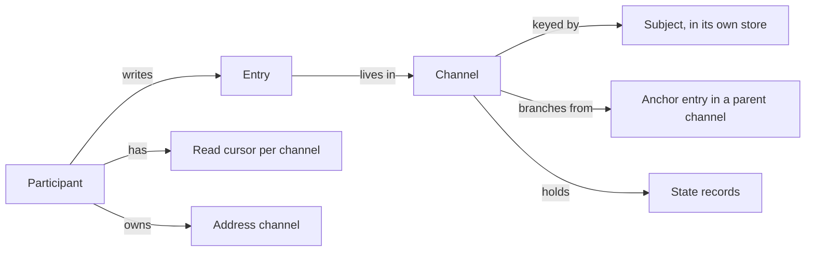

# cynapse: the persisted communication network for agents

> Root project spec: the **descriptive** top index for the `cynapse` CLI and library (the npm
> package at `packages/cynapse`). It states the design as the code, the ADRs in `docs/adr/`, and
> the sibling cyberuni projects (cyberlegion, cyberfleet, SDD, civitas) describe it today. It is a
> **draft**: it has not been through the spec gate, and the behavioral nodes below do not exist yet.
>
> Where the sources disagree, this spec says so and points to [`review.md`](./review.md) by label
> (`I` for an inconsistency, `M` for something missing). It does not pick a winner silently.

## What

cynapse is the place agents write down communication that has no other home: the record of what
happened, the discussion between agents, who said what to whom, and who has read it. It stores
**channels** of immutable **entries**, tracks a **read cursor** for each reader, and keeps small
**state records** for what is true right now (a question is pending, a channel needs input).

It runs as a local CLI and a Node library over one stock SQLite file. There is no daemon.

**Non-goals**

- It does not store work items, pull requests or tasks. GitHub, Asana, Linear and beads keep those.
  cynapse refers to them by shorthand (`gh:cyberuni/cynapse#12`) and never copies them (ADR-0002, ADR-0011).
- It holds no credentials and never calls an external service (ADR-0011).
- It never wakes anyone and never measures whether a session is alive. The runtime that runs the
  sessions does both (ADR-0013). See [I1](./review.md#i1) and [I4](./review.md#i4).
- It does not spawn sessions or drive panes. cyber-mux stays below it.
- It does not authenticate callers. `--as` is a claim (ADR-0013, ADR-0014). See [I13](./review.md#i13).

### Key terms

| Term | Plain meaning |
| --- | --- |
| Participant | Anyone who can write or read: an `agent`, a `human` or a `service`. Has a UUIDv5 id derived from a registration key. |
| Channel | An ordered, append-only list of entries with one order owner. The old word was "stream" (ADR-0009). |
| Entry | One immutable item in a channel. Identity is a UUIDv7 the writer mints. `seq` is the channel's arrival order. |
| Subject | The thing a channel is about: an issue, a PR, a task, a repository, a participant. |
| Address channel | A channel keyed by something that can receive messages (a participant, repository, project, folder). Has an owner. |
| Work channel | A channel keyed by a unit of work (issue, PR, task, mission). Has members and no owner. |
| Anchor | The entry in a parent channel that a child channel branches from. |
| Read cursor | Per reader, per channel: the last `seq` that reader has read. Only moves forward. |
| State record | What is true now on a channel (lifecycle, pending answer, needs-input). Every change is also an entry. |
| Tombstone | What stays of a deleted entry: its place (`seq`, thread links, author), not its content. |
| Change token | An opaque, store-local marker. "Channels that moved since this token." Not an order of entries. |

## Model

Rules that every capability shares (all built unless marked):

1. **Every change to channel metadata is also an entry** in that channel, written in the same
   transaction (`cynapse.*` types). Metadata includes membership, owner, lifecycle, state, tags,
   renames, participant registration and deletes.
2. **A message is an entry in the channel of what it is about.** Work traffic goes on the work
   channel; direct traffic goes on the addressee's address channel. There is no mailbox and no DM (ADR-0012, ADR-0013).
3. **A channel's identity is `UUIDv5` of its subject key** `subject:<store>:<nativeId>`, built only by
   `channelKey` / `channelIdOf`. A moved subject adds an alias key; it never re-keys (ADR-0012).
   A channel branched from an anchor uses `UUIDv5(anchor entry id)` instead (ADR-0004). See [I20](./review.md#i20).
4. **Entries are immutable.** Edit and retract are new entries ([M10](./review.md#m10) for edit). Deletion is a tombstone (ADR-0014).
5. **Order is per channel.** There is no global order. `seq` is assigned under `BEGIN IMMEDIATE`.
6. **Types and tags are namespaced and consumer-defined.** `cynapse.*` is reserved (ADR-0005).
7. **Raw conversation stays out of repositories.** Only distilled results go in (ADR-0007).

## Capabilities

Each row is a node to write. Status is what the code does today. **No node has a behavioral
spec or `.feature` suite yet** ([M15](./review.md#m15)); the ADRs and `*.test.ts` files are the only oracle.

| Node | Concern | CLI / library surface | ADRs | Status |
| --- | --- | --- | --- | --- |
| `channel/` | Create, show, list, tree, rename, resolve, alias keys, owner, pin, saved views, lifecycle | `channel *`, `createChannel`, `registerAddress`, `getChannelBySubject`, `addSubject`, `setOwner`, `views` | 0004, 0009, 0012 | built |
| `channel/membership` | Add and remove members after create | `addMember` (no remove) | 0013 | partial ([M2](./review.md#m2)) |
| `entry/` | Append (idempotent by id), list with filters, show, tags, search | `entry append\|list\|show`, `tag`, `append`, `entries`, `search`, `addTags` | 0003, 0005 | built; `search` not in CLI ([M10](./review.md#m10)) |
| `entry/conditional` | Append unless a matching entry exists ("at most once") | `appendUnless` | 0006 | built (library only) |
| `entry/delete` | Tombstone an entry or hide a channel | `entry delete`, `channel delete` | 0014 | built |
| `participant/` | Register, retire, rename, list, resolve by exact name | `participant *`, `resolveAddress` | 0013 | built |
| `message/send` | Send to a named participant's address channel | `entry send` | 0013 | built |
| `message/read-state` | Cursors, `unread` including followed threads, `handled` | `read`, `unread`, `cynapse.handled` | 0006, 0013 | built; one-way cursor ([I12](./review.md#i12)) |
| `message/wait` | Block for the first reply to one entry | `entry wait` (exit `3` on timeout) | 0013 | built; one thread only ([M1](./review.md#m1)) |
| `message/changes` | Cheap store-wide "what moved" token | `changes [--since]` | 0013 | built |
| `state/` | State records, lifecycle, pending answers, needs-input | `state *`, `setState`, `states`, `setLifecycle` | 0006 | built; no compare-and-set ([M4](./review.md#m4)) |
| `state/lease` | Claims with TTL, exclusivity, fencing | none (a free `--kind lease` only) | 0006 | **not built** ([I2](./review.md#i2), [M4](./review.md#m4)) |
| `store/` | Stock SQLite, WAL, forward migrations, `seq` under concurrency, `$CYNAPSE_HOME` | `openStore`, `resolveDbPath`, `dev load-test` | 0007 | built; ops commands missing ([M9](./review.md#m9)) |
| `errors/` | Stable codes and exit codes | `CynapseError`, `EXIT_*` | 0013 | partial: 3, 4, 5 defined; rest open ([M8](./review.md#m8)) |
| `output/` | Agent-friendly output, `--json`, empty states | `output`, `printEmpty` | n/a | built |
| `refs/` | Reference shorthand rendering | `renderRef`, `./refs` export | 0002 | built |
| `gui/` | The Council's viewer | `cynapse gui`, `packages/cynapse-gui` | n/a | built; separate package |
| `setup/` | `init-cynapse`, routes, conventions, stamps | `cynapse setup *` | 0008 | **not built** ([M14](./review.md#m14)) |
| `compose/` | Guide a consumer, compose a cross-store change feed from data the consumer fetched | library only | 0010, 0011 | **not built** ([M7](./review.md#m7)) |
| `publish/` | `cynapse.published` write-back record | an entry type | 0011 | **not built** ([M7](./review.md#m7)) |
| `sync/` | Hub as order owner, offline writers, access control | none | 0003, 0007 | **not built** ([M12](./review.md#m12)) |

## Use cases

Enumerated by actor, as the SDD format asks. Every goal has an entry point or a named gap.

| Actor | Goal | Entry point | Gap |
| --- | --- | --- | --- |
| Runtime (cyberlegion) | Give each session a durable address and keep it current | `participant register\|retire\|rename\|list` | none |
| Runtime | Send a brief or report about a work item | `entry append` on the work channel | none |
| Runtime | Send to a role by name | `entry send`, `resolveAddress` | many sessions acting as one handle ([M11](./review.md#m11)) |
| Runtime | Notice that something arrived, cheaply | `changes --since` | none |
| Runtime | Wait for a reply | `entry wait` | cross-channel wait ([M1](./review.md#m1)) |
| Runtime | Find a repository's channel | `channel resolve`, `channelKey` | project address recipe ([M5](./review.md#m5)) |
| Runtime | Hold an exclusive claim on a service or path | none | leases ([M4](./review.md#m4)) |
| Runtime | Retire its own message store | `entry delete`, `channel delete` | history import ([M16](./review.md#m16)) |
| Agent | See what is waiting for me | `unread`, `entry list --unread` | none |
| Agent | Mark an inbox message dealt with | `tag … cynapse.handled` (owner only) | none |
| Agent | Brief myself on a channel in one call | `channel show` | none |
| Agent | Record a decision or gate verdict | `entry append --type <ns>.decision` | consumer entry types ([M6](./review.md#m6)) |
| Agent | Branch a discussion (arbitration, thread) | `channel create --anchor` | thread type ([M6](./review.md#m6)) |
| Agent | Hold a question open past my own process | `state set --kind awaiting-reply` | contract is a convention only ([I7](./review.md#i7)) |
| Human (Council) | Browse and clean up conversations | `cynapse gui`, `channel delete` | none |
| Human | Triage my own inbox | `unread`, `cynapse.handled` | none |
| Observer | Watch a participant without disturbing them | own cursor on the address channel; `changes` + `entries --author` | none |
| Consumer plugin (SDD, cyberfleet, truss) | Define its own entry and channel types | namespaced `--type` | no registry or validation ([M6](./review.md#m6)) |
| Consumer | Write a decision back to GitHub or Asana | the consumer's own call, then `cynapse.published` | not built ([M7](./review.md#m7)) |
| Maintainer | Check the store is healthy, back it up | none | ([M9](./review.md#m9)) |

Stakeholders who do not invoke it: the person reading GitHub who must not see raw transcripts
(ADR-0011 write-back), and the next agent reading a distilled ledger.

## Control flow

Not drawn. The CFG for each node is written with the node ([M15](./review.md#m15)). The flows that
carry most risk, to draw first:

1. **Append**: `id` given? same payload returns stored entry; different payload `id_conflict`; parent in another channel is refused; `seq` assigned under the write lock.
2. **Send**: resolve name; one live match proceeds; several `ambiguous_address` (exit 4, candidates in `--json`); none `unknown_address` (exit 5); never creates a participant.
3. **Delete**: already tombstoned returns the logging entry; `cynapse.*` type refused; channel delete skips `cynapse.*`.
4. **Unread**: member channels plus followed threads, excluding own entries, tombstones and (once built) `cynapse.*` ([#74](https://github.com/spikyuni/cynapse/issues/74)).

## Integration contracts

What each neighbour relies on, taken from their own files. These are the compatibility surface
once `0.1.0` is the public contract (ADR-0013 item 6).

| Neighbour | Relies on | Source |
| --- | --- | --- |
| cyberlegion (optional peer `cynapse ^0.1.0`) | Synchronous `openStore`, `resolveDbPath`, `registerParticipant`, `retireParticipant`, `renameParticipant`, `participants({registeredBy})`, `getChannelBySubject`; `cynapse/sqlite-warning`; one `$CYNAPSE_HOME`; keys `cyberlegion:hub/<hash>` (service) and `cyberlegion:unit/<id>` (agent) | `cyberlegion/.agents/spec/unit/participants`, `participants.ts` |
| cyberlegion, next stages | `resolveAddress`, `parent` replies, `unread`, `changes`, `markRead`, delete; doorbell driven by `changes` and `wake` | cyberlegion#153 |
| cyberfleet | Channels and state records called directly; work channel per subject; `cynapse.published`; anchored child channels; `entry wait`; mentions; members after create | cyberfleet ADR-0023, ADR-0024, ADR-0030, `design/model.md` |
| SDD | Nothing yet. Its combat log and mission graph are candidates to move ([I11](./review.md#i11)) | cyber-sdd `combat-log`, `mission-graph` |
| cyber-truss | An arbitrator may summon peers into a channel; the decision still lands in the run record | `cyber-truss/docs/sessions/2026-09-13-model-review.md` |
| DNA | Network of subjects, relations on both ends, write through and keep no copy | `dna/spec.md` |
| Civitas | Runtime may depend on cynapse, never the reverse; cynapse never wakes; coordination claims in cynapse | civitas 0001, 0002, 0004 |

**Public surface rule.** A runtime codes against `Store` and the exported functions, never against
`SqliteStore`. The CLI's `--json` shapes equal the library's return shapes. Changing the `Store`
interface, the JSON shapes or the `cynapse.*` entry types is a breaking change (ADR-0013).
Three breaking changes are already queued: async `Store` (#71), renamed terms (#72), regrouped verbs (#75).
See [I6](./review.md#i6), [I8](./review.md#i8), [M8](./review.md#m8).

## Decisions that are expensive to undo

| Decision | Why it is load-bearing |
| --- | --- |
| Entry id = UUIDv7, `seq` owner-assigned, per channel | Every reference and cursor depends on it (ADR-0003) |
| Channel id = UUIDv5 of the key; key has no type | Written into every entry (ADR-0004, ADR-0012) |
| Participant id = UUIDv5(registration key) | Entry authors are written forever (ADR-0013) |
| Work traffic on work channels, direct on address channels | A conversation stays where it began (ADR-0013) |
| Cursor belongs to the participant, not the session | Lets a role's mail outlive its readers (ADR-0013) |
| cynapse holds no credentials and never calls a store | ADR-0011 |
| cynapse never wakes anyone and never measures liveness | ADR-0013 |
| Stock SQLite, no daemon, database outside any repo | ADR-0007 |
| Tombstones keep `seq` and thread shape | ADR-0014 |

Cheap to revisit: relation names, exact versus prefix matching in `resolveAddress`, followed-thread
rules, `handled` as a tag, the poll interval, the write-back triggers.

## Findings

[`review.md`](./review.md) lists 20 inconsistencies (`I1`–`I20`) and 18 gaps (`M1`–`M18`) found by
reading cynapse's ADRs, code and open issues against cyberlegion, cyberfleet, civitas, SDD,
cyber-mux, cyber-truss and DNA.
